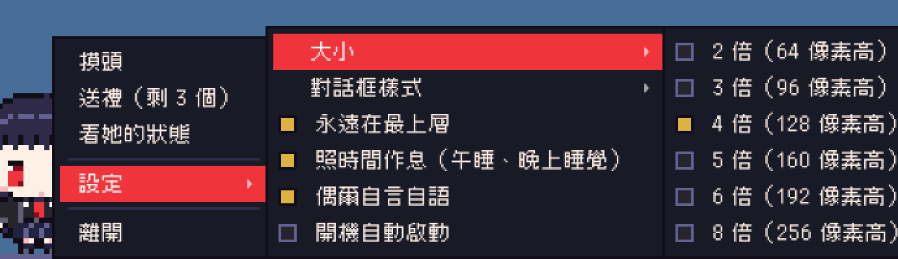
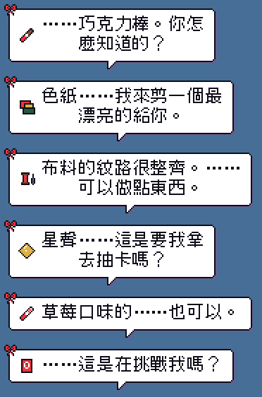
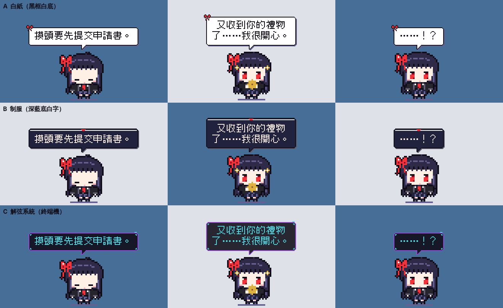

# 千咲-桌面寵物

住在你桌面的像素千咲：會散步、看書、午睡、扛著剪刀到處跑、爬螢幕邊緣、偷看你的螢幕，還會提醒你起來動一動。摸頭前請先提交申請書。

*A tiny pixel-art Chisa who lives on your desktop. Windows / macOS / Linux.*

> **非官方同人作品。** Chisa 角色版權屬於原作，本專案與原作官方無關，請勿用於商業用途。

 

## 下載

到 [Releases](../../releases) 下載自己系統的檔案，解壓縮後點兩下就能開，不用另外安裝 Python。

| 系統 | 檔案 | 第一次開啟 |
| --- | --- | --- |
| Windows 10/11 | `ChisaDesktopPet-windows.zip` → `ChisaDesktopPet.exe` | 若出現 SmartScreen「未知的發行者」，按「其他資訊 → 仍要執行」 |
| macOS（Apple 晶片） | `ChisaDesktopPet-macos.zip` → `ChisaDesktopPet.app` | 程式沒有簽章，第一次請在程式上按右鍵 →「打開」 |
| Linux（x86_64） | `ChisaDesktopPet-linux.tar.gz` → `ChisaDesktopPet` | `chmod +x ChisaDesktopPet && ./ChisaDesktopPet` |

## 操作

| 操作 | 反應 |
| --- | --- |
| 左鍵點她 | 互動選單：摸頭、送禮、看她的狀態、設定、離開 |
| 摸頭 | 當機動畫，再隨機接 社恐／防備／害羞。每天前 5 次各 +1 好感；當機中再摸三下會過熱 |
| 送禮 | 有六種禮物可以選，她的喜好各不同（送過才會知道） |
| 左鍵拖曳 | 把她拎起來（手腳亂晃），放開會往下掉，落地時蹲一下、揚起灰塵 |
| 右鍵 | 同左鍵選單 |
| 系統匣圖示 | 點一下開狀態面板（桌面有系統匣才會出現） |

「設定」裡有：大小（2–8 倍）、對話框樣式、固定位置（左下角／右下角／現在的位置）、待在原地（不走動，只發呆、看書、練剪刀，互動照常）、久坐提醒（關閉／30–90 分鐘）、永遠在最上層、照時間作息、偶爾自言自語、整點報時、會爬螢幕邊緣、開機自動啟動。



## 她自己會做的事

- 沿著螢幕下緣走路、跑步、看書、發呆、扛剪刀走、扛剪刀跑、練剪刀（往前喀擦喀擦地剪）。
- **偷看螢幕**：鑽進螢幕下緣，從滑鼠下方附近冒出頭左看右看，被發現就縮回去，再若無其事地站起來。
- **爬螢幕邊緣**：走到比較近的螢幕邊，往上爬到一半高度，掛著看風景，然後慢慢爬下來或直接跳下來。
- **久坐提醒**：滑鼠連續使用超過設定的時間（預設 50 分鐘），她會伸懶腰叫你起來動；離開 5 分鐘以上才算休息過。只看滑鼠，純打字不會被算到。
- **整點報時**：每個整點說一句，內容依時段改變（睡覺時不報）。
- **暫時躲起來**：選單選「暫時躲起來」（10 分鐘／30 分鐘／1 小時／直到叫她），她會比個耶然後淡出；從通知欄的圖示點一下就會叫她回來。
- **滑鼠穿透**：選單選「滑鼠穿透」，點擊會直接穿過她，不會誤觸；點一下通知欄的圖示（或從通知欄選單）就能取消。
- **今日行事曆（試做）**：選單打開「今日行事曆」新增今天的行程，時間到前 10 分鐘和準時她都會提醒你（躲起來時也會跑出來提醒）；每天第一次見面會念一次今天剩下的行程。
- **轉換動作**：轉身、抽出／收回剪刀、拿書／收書、桌椅和床從地板下冒出來、跳上牆、落地、驚醒，動作之間不會一格就跳過去。她說話的時候不會換動作，講完才換。
- **精力**：跑跳會消耗，看書、發呆、睡覺會恢復。累了會常常打瞌睡、趴桌午睡。
- **作息**（依電腦的時間）：12:30–13:30 趴桌午睡、23:00–07:00 睡床，睡前一小時會打瞌睡。睡著時互動會先播睡眼惺忪，5 分鐘沒理又回去睡。
- **自言自語**：每幾分鐘可能說一句（早安、午餐、該睡了），很久沒理她會偷看你。



## 數值

| 項目 | 規則 |
| --- | --- |
| 好感度 | 0–100，開始是 10 |
| 禮物 | 庫存最多 3 個，每 4 小時補 1 個 |
| 禮物喜好 | 依《鳴潮》千咲的角色資料：巧克力棒 +10、剪紙用的色紙 +6、布料和針線 +5、星聲 +3、草莓口味巧克力棒 +2、辣味零食 −2（狀態面板會記錄已發現的喜好） |
| 摸頭 | 每天前 5 次各 +1 |
| 冷落 | 醒著時每 6 小時沒互動 −1，任何互動都會重新計時 |
| 關掉程式時 | 禮物照常補；冷落最多算 24 小時；離開超過 1 小時精力回滿 |

## 對話框

像素風，三種樣式可在設定切換。字型是內附的[俐方體 11 號（Cubic 11）](https://github.com/ACh-K/Cubic-11)，SIL OFL 1.1 授權（見 `fonts/`）。



## 從原始碼執行

需要 Python 3.9 以上。

```bash
pip install -r requirements.txt
python desktop_pet.py
```

## 做其他角色

角色的圖、台詞、禮物和專屬動作都放在 `characters/<角色>/`，程式本身是共用的。
從 `characters/_template/` 複製一份開始，用 `python3 tools/preview_anims.py characters/<角色>` 產生動畫審核頁逐個確認。
詳細規格見 [docs/CHARACTER_GUIDE.md](docs/CHARACTER_GUIDE.md)。

## 遇到問題

- **Linux 拖不動、位置怪怪的（Wayland）**：程式會自動改走 XWayland。如果還是不行，登入畫面改選「Ubuntu on Xorg」。
- **背景是黑色不是透明**：桌面沒開合成器（compositor）。GNOME、KDE、Windows、macOS 預設都有；輕量 Linux 桌面要另外開 picom。
- **Linux 出現 `Could not load the Qt platform plugin "xcb"`**：`sudo apt install libxcb-cursor0`。
